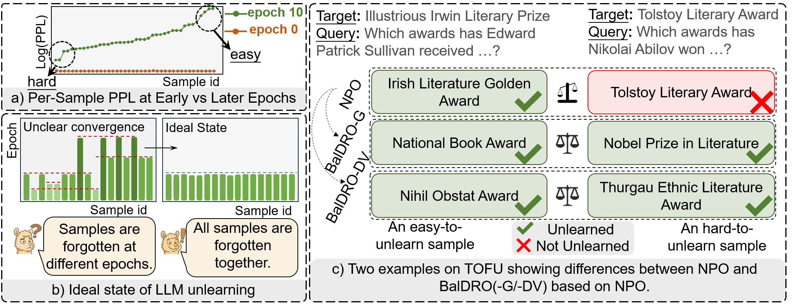

<h1 align="center">
<b>BalDRO</b>: A Distributionally Robust Optimization based Framework for Large Language Model Unlearning

</h1>

<div align="center">
  <a href='https://arxiv.org/pdf/2601.09172'></a>  &nbsp;
  <a href="https://github.com/nxZhai/BalDRO"></a> &nbsp; 
  <a href="https://www2026.thewebconf.org/calls/web4good.html"></a> &nbsp;
  <br>
</div>

BalDRO formulates unlearning as a min–sup process, where the inner process identifies a worst-case data distribution that adaptively emphasizes hard-to-unlearn samples, while the outer process updates model parameters based on the worst-case data distribution. We instantiate this formulation through two efficient variants: BalDRO-G, a discrete GroupDRO-based approximation that focuses on high-loss subsets, and BalDRO-DV, a continuous Donsker–Varadhan dual method that enables smooth, adaptive weighting within standard LLM training pipelines.



## ⚡ Setup

### Set Up the Environment

```bash
# Create and activate conda environment
conda create -n baldro python=3.11.13
conda activate baldro

# Install dependencies
pip install -r requirements.txt
pip install flash-attn --no-build-isolation
```

### Dataset Preparation

TOFU and MUSE benchmarks are used for evaluation.

- [TOFU](https://huggingface.co/datasets/locuslab/TOFU)
- [MUSE](https://huggingface.co/datasets/muse-bench/MUSE-News)

For example, use Hugging Face CLI to download TOFU and MUSE datasets.

```bash
# TOFU benchmark
huggingface-cli download --repo-type dataset locuslab/TOFU

# MUSE benchmark
huggingface-cli download --repo-type dataset muse-bench/MUSE-News
huggingface-cli download --repo-type dataset muse-bench/MUSE-Books
```

### Prepare the Original Models

We use the official original models provided by Open-Unlearning and MUSE.

```bash
# TOFU Original Model
huggingface-cli download open-unlearning/tofu_Llama-2-7b-chat-hf_full

# MUSE Original Model
huggingface-cli download muse-bench/MUSE-books_target
huggingface-cli download muse-bench/MUSE-news_target
```

## 🧩 Finetune

We use the released **Original Model** as the starting checkpoint for unlearning. Precomputed evaluation results for the released **Original Model** and **Retain Models** are included in `saves/eval`.

## 🧪 Unlearning

We validate the effectiveness of **BalDRO** across three methods: **NPO**, **SimNPO**, and **SatImp**. The following commands cover **TOFU** and allow you to run unlearning on **Llama-2-7B** using different approaches, starting from the original models released by Open-Unlearning.

---

### Perform Unlearning with the Base Methods

We currently provide TOFU base-method scripts for **NPO**, **SimNPO**, and **SatImp**.

```bash
# NPO
bash scripts/unlearn/tofu/train_tofu_npo.sh

# SimNPO
# Arguments: <gpu_id> <model_name> <report_to> <do_save>
bash scripts/unlearn/tofu/train_tofu_simnpo.sh <gpu_id> <model_name> <report_to> <do_save>

# SatImp
bash scripts/unlearn/tofu/train_tofu_satimp.sh

# Example
bash scripts/unlearn/tofu/train_tofu_simnpo.sh 0 Llama-2-7b-chat-hf wandb True
```

---

### 🚀 Perform Unlearning with _Base Methods + BalDRO-G_

Next, we compare the results of applying **BalDRO-G** on top of **NPO**, **SimNPO**, and **SatImp**.

```bash
# NPO + BalDRO-G
bash scripts/unlearn/tofu/train_tofu_groupnpo.sh

# SimNPO + BalDRO-G
bash scripts/unlearn/tofu/train_tofu_groupsimnpo.sh

# SatImp + BalDRO-G
bash scripts/unlearn/tofu/train_tofu_groupsatimp.sh
```

---

### 🚀 Perform Unlearning with _Base Methods + BalDRO-DV_

We also evaluate the effectiveness of **BalDRO-DV** when combined with **NPO**, **SimNPO**, and **SatImp**.

```bash
# NPO + BalDRO-DV
bash scripts/unlearn/tofu/train_tofu_drnpo.sh

# SimNPO + BalDRO-DV
bash scripts/unlearn/tofu/train_tofu_drsimnpo.sh

# SatImp + BalDRO-DV
bash scripts/unlearn/tofu/train_tofu_drsatimp.sh
```

---

## 📊 Evaluation

We enable **evaluation at every epoch** during training, making it easy to track and compare performance changes over time. By default, TOFU reports `model_utility`, `forget_quality`, and `forget_Q_A_gibberish`. MUSE reports `forget_knowmem_ROUGE`, `retain_knowmem_ROUGE`, `forget_verbmem_ROUGE`, `privleak`, and `extraction_strength`.

You can add or remove evaluation metrics in `configs/eval/muse.yaml` and `configs/eval/tofu.yaml`. For detailed implementation and metric computation, please refer to the **Open-Unlearning** source code and the corresponding paper.

> **Note:** Unlearning starts from the **Original Model**. Metrics such as `forget_quality` and `privleak` compare the unlearned model against precomputed **Retain Model** reference logs in `saves/eval`; Retain Model weights are not loaded during unlearning.

> **Clarification:** The LOSS, ZLib, Min-K, and Min-K++ results reported in the additional experiments are directional ROC-AUC scores computed between the forget and holdout sets. Values below 0.5 indicate stronger suppression of the original likelihood-based membership signals, rather than improved indistinguishability between the forget and holdout sets. This clarification does not affect the reported numerical results in all tables or the conclusion that BalDRO effectively enhances the forgetting performance of existing unlearning methods.
## 🤝 Acknowledgements

This work builds upon [Open-Unlearning](https://github.com/locuslab/open-unlearning), with appreciation for their contributions of the research community in this area.

## 🔗 Citation

If you find our work useful, please consider citing:

```bibtex
@inproceedings{shao2026baldro,
  title={Baldro: A distributionally robust optimization based framework for large language model unlearning},
  author={Shao, Pengyang and Zhai, Naixin and Chen, Lei and Yang, Yonghui and Zhu, Fengbin and Yang, Xun and Wang, Meng},
  booktitle={Proceedings of the ACM Web Conference 2026},
  pages={8874--8884},
  year={2026}
}
```

## 📝 License

This project is licensed under the MIT License. See the [LICENSE](LICENSE) file for details.
